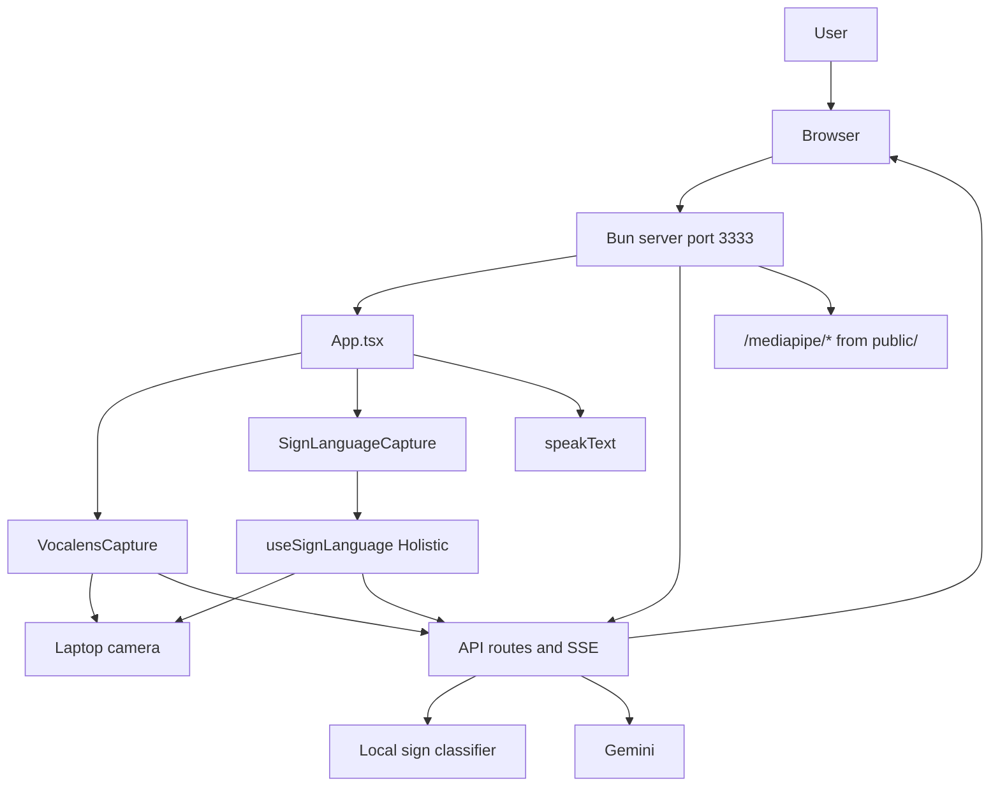
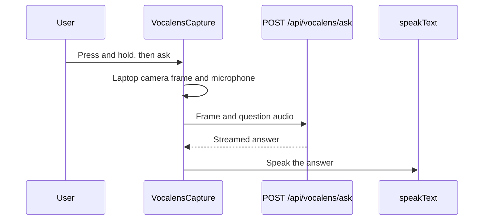
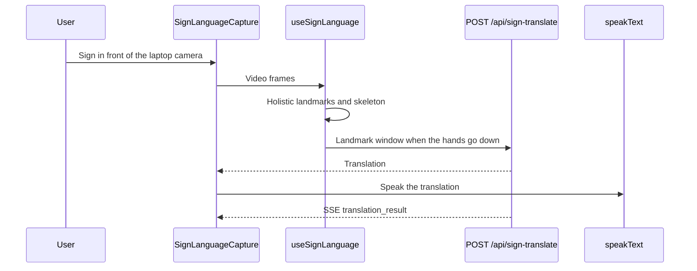

# VocaLens — Architecture & Troubleshooting

## Overview

VocaLens is one local web app. [`src/index.ts`](./src/index.ts) starts a single Bun server on `PORT` (default `3333`). That process serves the React page, the API, server-sent events, and MediaPipe files. The laptop camera is the only capture source. Speech plays in the browser.

Two modes share that page:

1. **Written Text**
   - [`src/webview/components/VocalensCapture.tsx`](./src/webview/components/VocalensCapture.tsx) uses the laptop camera
   - Press and hold to ask about the current frame
   - Whisper transcribes the question and Gemini answers it
   - [`speakText`](./src/webview/lib/speech.ts) reads the answer aloud

2. **Live Sign**
   - [`useSignLanguage`](./src/webview/hooks/useSignLanguage.ts) opens the laptop camera at the requested quality, today 720p
   - MediaPipe Holistic tracks pose, face, and both hands and draws the skeleton
   - A rolling landmark window is sent to `/api/sign-translate` when the hands go down
   - A local classifier answers when it is confident. Gemini interprets the sign when the classifier is unavailable or unsure
   - The page speaks the translation with `speakText`

## Current Architecture

## Server

One `Bun.serve` call owns every route:

- Webview fallback from [`src/webview/index.html`](./src/webview/index.html)
- API routes from [`src/api/routes.ts`](./src/api/routes.ts), including `/api/sign-translate` and `/api/stream`
- `/mediapipe/*`, which reads the matching file from `public/`

Hot reload is on when `NODE_ENV` is not `production`.

## Written Text Flow

## Live Sign Flow

The route always returns `spokeOnGlasses: false`. Nothing speaks outside the browser.

## Frontend Sign Pipeline

- [`src/webview/hooks/useSignLanguage.ts`](./src/webview/hooks/useSignLanguage.ts)
  - Opens `getUserMedia` for the laptop camera
  - Initializes Holistic and draws the skeleton
  - Keeps a rolling landmark window and emits a payload when the hands go down
  - Logs `[MP_TIMING][HOLISTIC]` when timing debug is on
- [`src/webview/components/SignLanguageCapture.tsx`](./src/webview/components/SignLanguageCapture.tsx)
  - Shows the laptop camera and the skeleton
  - Shows the API roundtrip
- [`src/webview/App.tsx`](./src/webview/App.tsx)
  - Posts the payload to `/api/sign-translate`
  - Speaks the returned text

### Why `fingerpose` is used

`fingerpose` is not the translator. It classifies coarse handshapes locally, shows those hints, and sends them along as non-authoritative context. The local classifier is the primary recognizer. Gemini is the fallback.

### Why `@sign/translate` is not on the critical path

The installed `@sign/translate` package is a much larger Angular project and is not imported on the request path. It is reference material.

## AI Services

### `gemini-ocr.ts`

Shared Gemini request helper used by translation, visual questions, transcription fallback, and the sign interpreter. It is not a glasses photo pipeline.

- Sends image bytes as Gemini `inline_data` when a caller needs vision
- Normalizes Gemini responses
- Retries transient errors
- Falls back across models

### `gemini-translate.ts`

Translates recognized text into the selected target language and reuses the same retry and model fallback behavior.

### `gemini-sign-interpreter.ts`

Used when the local classifier does not accept the sequence.

- Accepts the sign grid
- Treats fingerpose hints as secondary
- Returns concise English text
- Uses `GEMINI_SIGN_MODEL` when set, defaulting to `gemini-1.5-flash`
- Falls back to `gemini-2.5-flash` and `gemini-2.0-flash` if needed

## SSE

The page listens to `/api/stream` for:

- `status`
- `ocr_result`
- `translation_result`
- `error`
- `heartbeat`

Sign results use `translation_result` with `sourceType: "sign"`.

## Public Assets

The live hook loads Holistic from `/mediapipe/holistic/`. [`src/index.ts`](./src/index.ts) serves those files from `public/mediapipe/`. See [`public/README.md`](./public/README.md) for the copy step from `node_modules/@mediapipe/holistic/`.

## Runtime Requirements

In `.env`:

- `GEMINI_API_KEY` must be valid for translation and the sign fallback
- `OPENAI_API_KEY` is used for spoken questions
- `GEMINI_MODEL` is used for text translation and visual answers
- `GEMINI_SIGN_MODEL` is optional
- `PORT=3333` is optional. That is the default

The process does not read `MENTRAOS_API_KEY` or `PACKAGE_NAME`.

Recommended values:

- `GEMINI_MODEL=gemini-2.5-flash`
- `GEMINI_SIGN_MODEL=gemini-1.5-flash`

## Model Retry and Fallback Behavior

Gemini-backed services share the same retry philosophy:

- Retry transient errors (`429`, `500`, `503`) up to 3 times
- Backoff delays: `1s`, then `2s`
- Move to the next model if the current model is missing or continues failing transiently
- For vision and text translation, if the configured and built-in fallback models return `404`, the app queries Gemini's `models.list` endpoint and retries with an accessible `generateContent` model for that API key

Typical model order:

1. configured model from env
2. `gemini-2.5-flash`
3. `gemini-2.0-flash`
4. discovered accessible model from Gemini `models.list` if needed

For the sign interpreter specifically, that means:

1. `GEMINI_SIGN_MODEL` or `gemini-1.5-flash`
2. `gemini-2.5-flash`
3. `gemini-2.0-flash`

## Development Flow

From this repository:

- `bun run dev` or `bun src/index.ts` starts the one server
- Open `http://localhost:3333`
- `bun run dev-start` runs tests and can start the local classifier in the background. The ngrok URL it prints is not required

## Key Files

- [`src/index.ts`](./src/index.ts) — the Bun server
- [`src/api/routes.ts`](./src/api/routes.ts) — sign translation, training samples, language, and sign debug
- [`src/api/sse-stream.ts`](./src/api/sse-stream.ts) — SSE manager
- [`src/webview/hooks/useSignLanguage.ts`](./src/webview/hooks/useSignLanguage.ts) — laptop camera, Holistic, and the landmark window
- [`src/webview/components/SignLanguageCapture.tsx`](./src/webview/components/SignLanguageCapture.tsx) — sign UI
- [`src/webview/components/VocalensCapture.tsx`](./src/webview/components/VocalensCapture.tsx) — written text
- [`src/webview/lib/speech.ts`](./src/webview/lib/speech.ts) — browser speech

## Troubleshooting

### The page does not load

- Run `bun src/index.ts` or `bun run dev`
- Open `http://localhost:3333`
- If the port is taken, stop the other process or set `PORT`

### The sign skeleton does not render

- Allow the laptop camera
- Confirm `/mediapipe/holistic/` requests return `200`
- If those files 404, copy `node_modules/@mediapipe/holistic/` into `public/mediapipe/holistic/` as described in [`public/README.md`](./public/README.md)

### Sign capture works, but `/api/sign-translate` fails

- Check that `GEMINI_API_KEY` is set when the local classifier cannot answer
- If you set `GEMINI_SIGN_MODEL`, verify that model is available to your API key
- Watch the API debug card in the sign panel

### A translation is not spoken

- The browser has to allow speech synthesis
- The page speaks after `/api/sign-translate` returns text. A training-sample save does not speak
- `spokeOnGlasses` in the JSON body is always `false`

### SSE history updates, but status never clears

- The page expects `status: "ready"` after interpretation
- If the route throws before that broadcast, the status stays in between until the next event

## Security Notes

- Keep real keys in `.env` only
- Do not commit secrets
- Treat sign grids and camera frames as sensitive user input
- Use separate development and production Gemini keys when possible
