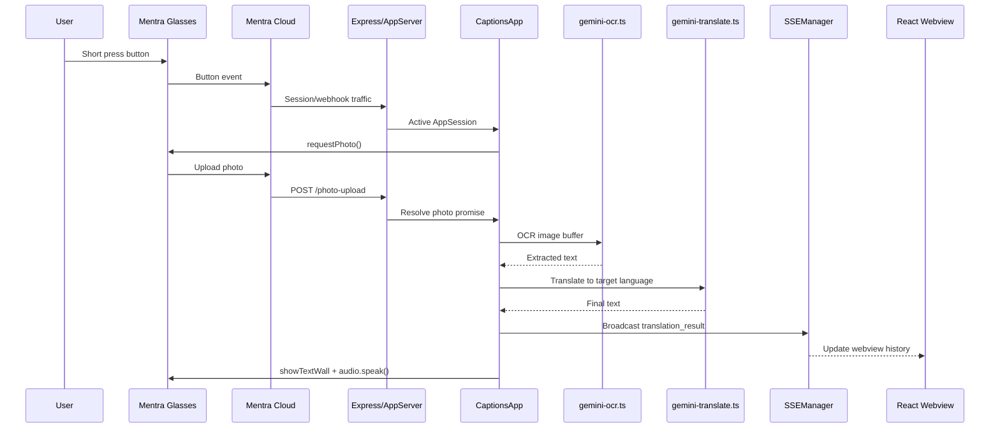
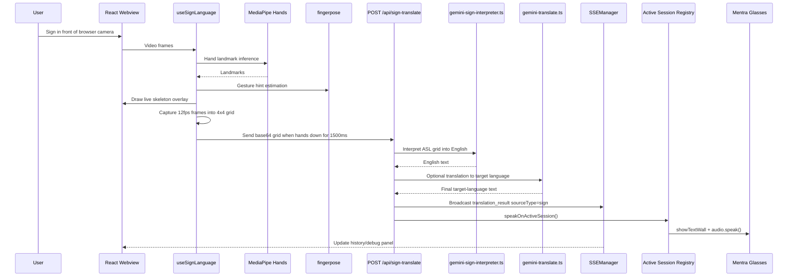

# VocaLens — Architecture & Troubleshooting

## Overview

This app now has **two input pipelines** that converge on the same output surfaces:

1. **Whiteboard OCR mode**
   - Uses the Mentra Live glasses camera
   - Extracts text from a captured photo with Gemini OCR
   - Optionally translates that text to the selected target language
   - Speaks the result on the glasses and updates the text wall

2. **ASL sign translation mode**
   - Uses the webview/browser camera in the React frontend
   - Tracks hands with MediaPipe Hands and renders a live skeleton overlay
   - Records a chronological `4 x 4` sign grid when the user signs
   - Sends the grid to Gemini for ASL-to-English interpretation
   - Optionally translates the English result to the selected target language
   - Speaks the result on the active glasses session and pushes it into the same SSE/UI history

## Current Architecture

```mermaid
flowchart TD
  User[User] --> Glasses[Mentra Live Glasses]
  User --> Browser[React Webview]

  Glasses --> Cloud[Mentra Cloud]
  Cloud --> Express[Express + Mentra AppServer<br/>port 3333]
  Express --> Bun[Bun Server<br/>port 3334]

  Express --> ActiveSession[Active Session Registry]
  Express --> Public[public/<br/>MediaPipe WASM assets]
  Express --> SSE[SSEManager]

  Bun --> Webview[App.tsx + SignLanguageCapture]
  Bun --> ApiRoutes[/api/settings/language<br/>/api/sign-translate]

  Browser --> Webview
  Webview --> MediaPipe[useSignLanguage + @mediapipe/hands]
  MediaPipe --> Fingerpose[fingerpose gesture hints]
  MediaPipe --> Grid[4x4 temporal grid]
  Grid --> ApiRoutes

  Glasses --> CaptionsApp[CaptionsApp]
  CaptionsApp --> OCR[gemini-ocr.ts]
  OCR --> Gemini[Google Gemini API]

  ApiRoutes --> SignInterpreter[gemini-sign-interpreter.ts]
  SignInterpreter --> Gemini
  ApiRoutes --> Translate[gemini-translate.ts]
  Translate --> Gemini

  CaptionsApp --> Translate
  CaptionsApp --> SSE
  ApiRoutes --> SSE
  SSE --> Browser

  CaptionsApp --> ActiveSession
  ApiRoutes --> ActiveSession
  ActiveSession --> Glasses
```

## Server Topology

The app uses a **dual-server setup**:

- **Express / Mentra AppServer** on port `3333`
  - Owns Mentra session lifecycle
  - Receives webhook and photo-upload callbacks from Mentra Cloud
  - Serves SSE directly at `/api/stream`
  - Serves static files from `public/`
  - Tracks the active Mentra session so the API can speak on the glasses
  - Proxies unmatched webview/API requests to Bun

- **Bun server** on port `3334`
  - Serves the React webview
  - Hosts Bun route handlers such as `/api/sign-translate`
  - Provides hot reload during development

This means:

- Mentra Cloud and glasses traffic enters through **Express**
- Browser/webview rendering is hosted by **Bun**
- MediaPipe runtime files are served from **Express `public/`**

## Whiteboard OCR Flow



## ASL Sign Translation Flow



## Frontend Sign Pipeline

The sign-language frontend lives in the React webview and centers around:

- [`src/webview/hooks/useSignLanguage.ts`](./src/webview/hooks/useSignLanguage.ts)
  - Starts/stops browser camera access
  - Initializes and cleans up MediaPipe Hands
  - Draws live landmark joints and hand connections on a visible canvas
  - Tracks `isSigning`
  - Debounces “hands down” for `1500ms`
  - Samples frames at `12fps`
  - Builds a chronological `4 x 4` hidden grid canvas
  - Emits a base64 JPEG payload when signing stops

- [`src/webview/components/SignLanguageCapture.tsx`](./src/webview/components/SignLanguageCapture.tsx)
  - Layers the webcam video and the skeleton canvas
  - Shows fingerpose hints
  - Shows the latest captured sign grid
  - Shows API roundtrip debug information

- [`src/webview/App.tsx`](./src/webview/App.tsx)
  - Hosts both OCR translation history and the ASL capture UI
  - Posts sign-grid payloads to `/api/sign-translate`
  - Renders SSE-driven translation cards for both OCR and sign results

### Why `fingerpose` is used

`fingerpose` is **not** the main translator. It is used as a lightweight helper to:

- classify coarse handshapes locally
- provide debug hints in the UI
- send noisy auxiliary gesture hints into the Gemini sign prompt

This improves observability and may help Gemini disambiguate some sequences, but the **actual ASL phrase interpretation** still happens in Gemini using the temporal grid.

### Why `@sign/translate` is not on the critical path

The installed `@sign/translate` package is a much larger Angular-based project and is **not** used as a direct runtime dependency in this architecture. For this app, it currently serves better as reference material than as an imported execution path.

## AI Services

### `gemini-ocr.ts`

Used by the glasses photo pipeline.

- Sends image bytes as Gemini `inline_data`
- Uses an OCR-only prompt
- Normalizes Gemini responses
- Retries transient errors
- Falls back across models

### `gemini-translate.ts`

Shared by both pipelines.

- Detects source language
- Translates into the selected target language
- Returns structured translation metadata
- Reuses the same retry and model fallback behavior

### `gemini-sign-interpreter.ts`

Used by the ASL sign-grid route.

- Accepts a base64 JPEG sign grid
- Uses a system prompt that explains the grid is a **chronological ASL sequence**
- Treats fingerpose hints as secondary/non-authoritative hints
- Returns concise English text
- Uses `GEMINI_SIGN_MODEL` when set, defaulting to `gemini-1.5-flash`
- Falls back to `gemini-2.5-flash` and `gemini-2.0-flash` if needed

## SSE and Shared Output Surface

Both input modes feed a shared SSE stream:

- `status`
- `ocr_result`
- `translation_result`
- `error`
- `heartbeat`

Important detail:

- Sign results reuse the **same `translation_result` event** as OCR
- Sign results include extra metadata such as:
  - `sourceType: "sign"`
  - `sourceLabel: "ASL Grid"`
  - `sourceModel`
  - `frameCount`
  - `spokeOnGlasses`

This keeps the frontend history unified while still letting the UI distinguish OCR cards from sign cards.

## Active Session Speech Bridge

The sign translation route is not inside `CaptionsApp`, so it cannot directly call `session.audio.speak()` unless a session is discoverable.

That is why the app uses:

- [`src/app/active-session.ts`](./src/app/active-session.ts)
  - stores the most recent live `AppSession`
  - exposes `speakOnActiveSession()`

- [`src/app/CaptionsApp.ts`](./src/app/CaptionsApp.ts)
  - registers sessions on connect
  - unregisters sessions on disconnect

This allows `/api/sign-translate` to speak results on the currently active glasses session.

## Public Assets

MediaPipe runtime assets are expected at:

- `public/mediapipe/hands/*`

The hook resolves files such as:

- `/mediapipe/hands/hands.binarypb`
- `/mediapipe/hands/hands_solution_wasm_bin.wasm`
- `/mediapipe/hands/hands_solution_simd_wasm_bin.wasm`

The app serves `public/` through the Express AppServer via:

- `publicDir: "./public"` in [`src/index.ts`](./src/index.ts)

Setup note:

- Copy the contents of `node_modules/@mediapipe/hands/` into `public/mediapipe/hands/`
- See [`public/README.md`](./public/README.md)

## Runtime Requirements

In `.env`:

- `PACKAGE_NAME` must exactly match the Mentra app package in the Mentra console
- `MENTRAOS_API_KEY` must be the app API key for that package
- `GEMINI_API_KEY` must be valid and active
- `GEMINI_MODEL` is used for OCR and text translation
- `GEMINI_SIGN_MODEL` is optional and is used for ASL sign interpretation
- `PORT=3333`

Optional:

- `NGROK_DOMAIN` for a stable tunnel URL during development

Recommended values:

- `GEMINI_MODEL=gemini-2.5-flash`
- `GEMINI_SIGN_MODEL=gemini-1.5-flash`

## Model Retry and Fallback Behavior

All Gemini-backed services share the same retry philosophy:

- Retry transient errors (`429`, `500`, `503`) up to 3 times
- Backoff delays: `1s`, then `2s`
- Move to the next model if the current model is missing or continues failing transiently
- For OCR and text translation, if the configured and built-in fallback models return `404`, the app queries Gemini's `models.list` endpoint and retries with an accessible `generateContent` model for that API key

Typical model order:

1. configured model from env
2. `gemini-2.5-flash`
3. `gemini-2.0-flash`
4. discovered accessible model from Gemini `models.list` if needed

For the sign interpreter specifically, that means:

1. `GEMINI_SIGN_MODEL` or `gemini-1.5-flash`
2. `gemini-2.5-flash`
3. `gemini-2.0-flash`

## Development Flow

From this repository:

- `bun run dev`
  - runs the dual-server app locally
- `bun run dev-start`
  - runs tests first
  - starts the app in the background
  - starts an ngrok tunnel
  - prints the public tunnel URL
- `bun run dev-stop`
  - stops both the app and tunnel
- `bun run dev-restart`
  - restarts both

## Mentra Console Settings

- App visibility: typically `private` during development
- `publicUrl`: current ngrok HTTPS URL
- `webviewURL`: same ngrok HTTPS URL
- Required capabilities:
  - `CAMERA` for whiteboard OCR mode
  - `SPEAKER` so the app can speak on the glasses

Notes:

- The **sign pipeline uses the webview/browser camera**, not the glasses camera
- The **OCR pipeline uses the glasses camera**

## Key Files

- [`src/index.ts`](./src/index.ts)
  - boots Bun + Express/AppServer
  - serves the webview, APIs, SSE, and public assets
- [`src/app/CaptionsApp.ts`](./src/app/CaptionsApp.ts)
  - Mentra session logic for glasses-driven OCR
- [`src/app/active-session.ts`](./src/app/active-session.ts)
  - active session registry so API routes can speak on the glasses
- [`src/api/routes.ts`](./src/api/routes.ts)
  - Bun routes including `/api/sign-translate`
- [`src/api/sse-stream.ts`](./src/api/sse-stream.ts)
  - SSE manager and event stream implementation
- [`src/services/gemini-ocr.ts`](./src/services/gemini-ocr.ts)
  - OCR service
- [`src/services/gemini-translate.ts`](./src/services/gemini-translate.ts)
  - shared text translation service
- [`src/services/gemini-sign-interpreter.ts`](./src/services/gemini-sign-interpreter.ts)
  - ASL grid interpretation service
- [`src/webview/hooks/useSignLanguage.ts`](./src/webview/hooks/useSignLanguage.ts)
  - MediaPipe + grid-capture hook
- [`src/webview/components/SignLanguageCapture.tsx`](./src/webview/components/SignLanguageCapture.tsx)
  - sign capture UI and debug panel

## Troubleshooting

### App shows "inactive"

- Ensure the local app is running
- Ensure ngrok is active
- Verify `publicUrl` and `webviewURL` match the current tunnel URL
- Confirm `PACKAGE_NAME` matches the Mentra console package exactly
- Confirm `MENTRAOS_API_KEY` belongs to that package

### Whiteboard photo request times out

- This usually means Mentra Cloud is still using a stale `publicUrl`
- After updating `publicUrl`, **relaunch the app on the glasses**
- The cloud caches app callback URLs for the lifetime of the session

### Sign skeleton does not render

- Confirm the browser/webview camera permission is granted
- Confirm MediaPipe assets exist under `public/mediapipe/hands/`
- Open the network tab and verify requests to `/mediapipe/hands/...` return `200`
- If those files 404, the hook can initialize incorrectly or fail silently

### Sign capture works, but `/api/sign-translate` fails

- Check that `GEMINI_API_KEY` is set
- If you set `GEMINI_SIGN_MODEL`, verify that model is available to your API key
- Watch the API debug card in the sign capture panel for latency and server errors

### Sign result does not speak on the glasses

- Make sure a Mentra session is active
- The active session registry only speaks when at least one session is connected
- If the webview is open but no glasses session exists, the API can still interpret signs, but `speakOnGlasses` will be false

### SSE history updates, but status never clears

- The frontend expects `status: "ready"` after interpretation/translation
- If the route throws before the ready status broadcast, the UI may remain in an in-between state until the next event

### Session connects then disconnects immediately

- Check logs from `CaptionsApp` with `logLevel: "debug"`
- Common causes:
  - wrong `MENTRAOS_API_KEY`
  - mismatched `PACKAGE_NAME`
  - cloud-side rejection of the session websocket

## Security Notes

- Keep real keys in `.env` only
- Do not commit secrets
- Treat sign grids and OCR photos as sensitive user input
- Use separate development and production Gemini keys when possible

## Future Improvements

- Persist sign translation sessions per user rather than using the latest active session
- Add phrase chunking or confidence hints for long sign sequences
- Add a dedicated SSE event type for sign interpretation before text translation
- Add optional server-side storage for recent debug grids in development only
- Add tests for `/api/sign-translate` route behavior end-to-end
