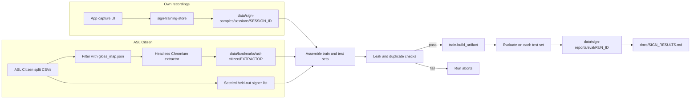

# Sign classifier evaluation plan

Status: draft, waiting for approval. No code has been written.

Date: November 5, 2026.

This plan builds the evaluation setup for the eight-sign classifier (yes, wait, thank you, no, stop, again, help, please). It measures whether adding a public dataset improves accuracy on the team's own camera. It builds on the trainer, vectorizer, and extractor already in the repo. It does not add a second pipeline.

## Scope decisions

These were confirmed on November 5, 2026:

- This request is the team's confirmation that the sign classifier is in scope. On approval, the "Open confirmation" note in `docs/ROADMAP.md` is updated to say so and to point at this file. Updated November 7, 2026: additional datasets (MS-ASL, Kaggle) may be added one at a time, each after it passes the checks in `docs/DATA_LICENSES.md` (Decisions).
- ASL Citizen videos go through the app's own browser extractor (`@mediapipe/holistic` 0.5.1675471629 plus `buildNormalizedLandmarkFrame` from `src/webview/hooks/useSignLanguage.ts`), run in headless Chromium. Every clip gets the same stamp as a live capture: `mediapipe-holistic-js@0.5.1675471629+schema-v2`.
- Only schema-v2 recordings are used. The 366 schema-v1 recordings from April 14, 2026, are excluded from every run. They are not deleted.

## What exists today

- **Extractor (browser).** `src/webview/hooks/useSignLanguage.ts` runs Holistic with `modelComplexity` 2, `smoothLandmarks`, `refineFaceLandmarks`, a detection confidence of 0.7, and a tracking confidence of 0.65. It samples at `DEFAULT_CAPTURE_FPS` = 24 and keeps a rolling window of `MAX_SEQUENCE_FRAMES` = 48. The version lock is in `src/sign/extractor-version.ts` and `sign_classifier_service/extractor_version.py`.
- **Sample store.** `src/services/sign-training-store.ts` writes `data/sign-samples/<label>/<id>.json` plus an RGB grid JPG and a skeleton image. Samples carry no session, signer, or day field.
- **Trainer.** `sign_classifier_service/train.py` has `build_artifact`, `train_softmax_classifier`, and `evaluate_artifact`, and it accepts external records through `load_manifest_examples`. It refuses to train on mixed extractor versions. Its `stratified_split` splits **by clip**. That is a leak, and the evaluation harness will not use it.
- **Features.** `vectorize_sequence` in `sign_classifier_service/classifier.py` produces 344 features from 24 resampled frames.
- **Reports.** `sign_classifier_service/report_results.py` writes to `data/sign-reports/<model-version>/`.
- **Data on disk.** `data/sign-samples/` holds 366 schema-v1 clips for seven signs, all recorded on April 14, 2026. The `wait` folder holds 6 schema-v2 clips from April 20 and 21, 2026. There is no held-out session. `data/asl-citizen/` is absent.

## Data flow



## 1. Fixed test sets

None of the test sets below ever receives training data. Each one is scored and reported separately.

### 1a. Own held-out recordings (primary test)

Recordings are grouped into **sessions**. A session is one sitting: one signer, one day, one setup.

Folder layout. This is all inside `data/sign-samples/`, which is already gitignored except `README.md`:

```
data/sign-samples/
  sessions/
    2026-11-10_owner_desk-daylight/
      session.json
      yes/<sampleId>.json  (+ -rgb.jpg, -skeleton.png)
      wait/...
    2026-11-14_owner_kitchen-evening/
      session.json
      ...
  <label>/...            legacy flat layout, never read by the evaluation
```

`session.json` is written once by a CLI command and cannot be edited through any command:

```json
{
  "sessionId": "2026-11-14_owner_kitchen-evening",
  "role": "test",
  "signer": "owner",
  "recordedOn": "2026-11-14",
  "lighting": "kitchen-evening",
  "camera": "iphone13",
  "extractorVersion": "mediapipe-holistic-js@0.5.1675471629+schema-v2",
  "createdAt": "2026-11-14T03:12:00Z"
}
```

How a session is created and labeled:

- `python -m sign_classifier_service.eval.sessions new --role train|validation|test --signer owner --lighting <tag> --camera <tag>` creates the folder and `session.json`. The session ID is derived as `<date>_<signer>_<lighting>`. The command refuses to overwrite an existing session.
- The capture server gets the active session from `SIGN_TRAINING_SESSION=<sessionId>`. `saveSignTrainingSample` writes into that session's folder and stamps `sessionId`, `signer`, and `role` on each sample. It refuses to save if the variable is set and `session.json` is missing. If the variable is unset, the store keeps today's flat layout, so Live Sign capture still works. Flat-layout samples are never used by the evaluation.
- Test session IDs are also listed in a **committed** registry, `sign_classifier_service/eval/test_sessions.json`. Because the registry is in git, moving a session into or out of the test set shows up in review. A session counts as test if either the registry or its `session.json` says so. If the two disagree, the run fails.
- A test session must differ from every training session of the same signer in `recordedOn` or in `lighting`. Same day plus same lighting fails the run.

- **Validation sessions** (`--role validation`, added November 7, 2026) are recorded by `owner` only, separately from training and test sessions. They are never trained on or tested on. The runner uses them, and only them, for early stopping and model selection: it scores validation loss every epoch, stops after `training.earlyStopping.patience` epochs without improvement, and keeps the best epoch's weights. A validation session must differ from every test session in `recordedOn` or `lighting`, must not be listed in `test_sessions.json`, and must share no clip (by landmark hash or near-duplicate distance) with training or any test set. If no validation session exists, the run stops; it never falls back to a test set. `validationRatio` and `group_split` are unchanged. With a ratio above 0, they hold out whole training groups as a reported diagnostic that is never used for stopping or selection.

Signer `owner` means you. Test sessions from `owner` form test set **own-heldout**. Test sessions from any other signer form test set **team** (the optional teammate signers). A teammate never contributes training sessions unless that is added later as a separate experiment.

### 1b. ASL Citizen held-out signers

- Input: the participant IDs in the ASL Citizen split CSVs (train, val, and test combined; the official splits are not used).
- Eligible signers: those with at least one clip in every gloss that `gloss_map.json` maps for ASL Citizen.
- Selection: sort the eligible IDs, then `random.Random(603).sample(eligible, k=10)`. Seed 603 and k = 10 are fixed in `sign_classifier_service/eval/config.json`.
- Saved to `data/sign-eval/asl-citizen-test-signers.json`, along with the seed, k, the eligibility rule, the eligible count, and a SHA-256 of each CSV used. The file is gitignored, because signer IDs come from the dataset and `docs/DATA_LICENSES.md` keeps derived data local. Anyone can regenerate the same list from the committed seed and code.
- After the file exists, the selection command refuses to regenerate it. Every run verifies that the CSV hashes still match and fails if they changed.
- Test set name: **asl-citizen-heldout**. All other ASL Citizen signers can be used for training.

## 2. Leak prevention (enforced in code)

All checks live in `sign_classifier_service/eval/leakage.py`. They run before training. Any failure aborts the run with a non-zero exit code, writes `leak-check.json`, and trains nothing.

- **Group split, never by clip.** Every example carries a group key: `asl-citizen:<participantId>` for ASL Citizen and `own:<sessionId>` for local recordings. Validation for training diagnostics uses whole groups (`group_split` in `train.py`). The harness never calls `stratified_split`, and a unit test asserts that.
- **Test-signer check.** The run fails if any training example has an ASL Citizen participant ID in the held-out list.
- **Test-session check.** The run fails if any training example's session is a test session, or if a test session is listed in a training config.
- **Signer check for teammates.** The run fails if a training example's signer belongs to the team test set.
- **Extractor check.** The run fails if any example's stamp is not `mediapipe-holistic-js@0.5.1675471629+schema-v2`. This is how schema-v1 clips are excluded.

### Duplicate detection

1. **By source ID (exact).** For ASL Citizen, the ID is the video file name from the CSV. A video ID that appears on both the train and test sides fails the run, and a repeated ID within training is dropped and counted. Local recordings have no source video. Each local sample instead gets a SHA-256 of its landmark coordinates rounded to 4 decimals, which catches the same file copied between session folders. A matching hash across train and test fails the run.
2. **By landmark similarity (near-duplicate).** This catches the same clip re-exported or re-extracted, where no shared ID exists.
   - Representation: resample each clip to 24 frames (the same `_resample_frames` the vectorizer uses), then take pose wrists, elbows, and shoulders plus both hands (42 points). Coordinates are already normalized by `buildNormalizedLandmarkFrame`.
   - Distance: the mean Euclidean distance per joint per frame. A hand present in one clip and missing in the other at the same frame adds a fixed penalty of 1.0.
   - Scope: compare each test clip with every training clip of the same label. This is a few hundred clips per label, so brute force is fine.
   - Threshold: a pair is a duplicate if the distance is below **0.01**. Coordinates are scaled by shoulder width, so 0.01 is about 1% of shoulder width. That is far smaller than any two separate performances, while re-encoding and re-extraction drift stays below it.
   - Calibration: each run logs the 0.1th-percentile distance between clips that are known to be distinct (same signer and label, different sessions or participants). If that value is below 0.02, the run fails and asks for the threshold to be reviewed, because a threshold that close to genuine clips can't separate duplicates from repeats.
   - Any train-test pair below the threshold fails the run. Pairs within training are reported only.

## 3. Gloss mapping

A single committed file, `sign_classifier_service/eval/gloss_map.json`:

```json
{
  "classes": ["wait", "help", "yes", "no", "stop", "again", "thank_you", "please"],
  "datasets": {
    "own": {"wait": "wait", "help": "help", "...": "..."},
    "asl-citizen": {"YES": "yes", "NO": "no", "THANKYOU": "thank_you", "...": "..."}
  }
}
```

- The ASL Citizen keys are filled in from the real gloss strings in the CSV once you supply the data. The filter prints every gloss containing one of the eight English words, such as `STOP1` or `THANK YOU`, so you choose which variants map. Nothing is guessed in advance.
- Labels not in the map are dropped. Each run reports the count of dropped clips per dataset, and the top 20 dropped glosses that contain an English word from our list.
- A class with no ASL Citizen gloss is recorded as a gap in the report. It is filled only by a later dataset that passes the checks in `docs/DATA_LICENSES.md` (Decisions) and is kept.

## 4. ASL Citizen extraction (same extractor as the app)

- `scripts/sign-extract/` holds a small page bundled with Bun that imports `Holistic` and the exported `buildNormalizedLandmarkFrame` from `useSignLanguage.ts`. The Holistic options are moved into one exported constant, `HOLISTIC_OPTIONS`, which the live hook and the offline page both use, so they cannot drift apart. Model files load from the existing `public/mediapipe/holistic/`.
- A Playwright driver (`scripts/sign-extract/extract-videos.ts`) serves the page and the local video files on localhost. It steps each video at 1000/24 ms, awaits `onResults`, and builds frames exactly as the live path does. It trims to the span where a hand is visible, then keeps up to 48 frames ending at the last visible frame, which matches the app's rolling window.
- Each record goes to `data/landmarks/asl-citizen/<extractorVersion>/clips.jsonl` with the fields `label`, `sourceGloss`, `dataset`, `signerId`, `sourceVideoId`, `landmarkSequence`, `frameTimestamps`, `extractorVersion`, and `extractionMode: "offline-video"`. Extraction can be resumed by video ID.
- The run logs a handedness check: the share of left-hand-dominant clips per one-handed sign, compared between own recordings and ASL Citizen. A large mirror mismatch is flagged in the report and does not stop the run.
- New dependency: `playwright` as a devDependency, plus `bunx playwright install chromium`. This downloads a browser binary, not a dataset.

## 5. Experiment loop

- Run configs are committed in `sign_classifier_service/eval/experiments/`:
  - `baseline.json`: training data = own training sessions only.
  - `plus-asl-citizen.json`: the baseline training data plus ASL Citizen training signers.
- Datasets are added one at a time. Each candidate is "last kept configuration plus one dataset". Today only ASL Citizen has code in the harness. A later dataset (MS-ASL, Kaggle) is added only after it passes the checks in `docs/DATA_LICENSES.md` (Decisions).
- Runner: `python -m sign_classifier_service.eval.run --experiment baseline`. It assembles data, runs the leak checks, trains with `train.build_artifact` (default learning rate and weight decay, at most the default epochs with early stopping on the validation sessions; seed 42), and evaluates once on every test set that has data after training finishes.
- Determinism: examples are sorted by a stable key before training, and the seed drives every shuffle and group split. The saved `config.json` holds the resolved experiment config, seed, hyperparameters, git commit, extractor version, the SHA-256 of the held-out signer file and the gloss map, and the list of session IDs and counts used.
- The model is written to `models/sign/<runId>.json`, which is gitignored. The harness never touches `data/sign-models/active-model.json`, so Live Sign keeps its current model.

## 6. Metrics and the keep rule

For each run, and for each test set (own-heldout, asl-citizen-heldout, team) separately:

- Overall accuracy (argmax over the eight classes) and clip count.
- Per-sign accuracy (recall) and support.
- A confusion matrix of true sign by predicted sign.
- Training clip counts per sign, split by source. A warning is shown when the largest class is more than twice the smallest, reusing `maybe_print_imbalance_warning`.
- A 95% bootstrap interval on overall accuracy (1,000 resamples, seed 42), so a small gain can be read as noise or not.
- Counts of clips dropped by the gloss map and by duplicate detection.

**Keep rule:** a dataset is kept only if overall accuracy on **own-heldout** is strictly higher than in the run it extends. The ASL Citizen and team numbers are reported but do not decide. If own-heldout has no clips, the run still trains and reports, but its decision is `undecided`, and nothing is marked kept.

The parent run is the latest run of the extended experiment on the same own-heldout clips. It must also have used the same validation sessions: the same session IDs, holding the same clips. If they differ, or the parent run does not record its validation sessions, the run stops before training with a message naming both sets, and asks for the parent experiment to be rerun first.

## 7. Outputs

- `data/sign-reports/eval/<runId>/` (gitignored): `config.json`, `metrics.json`, `leak-check.json`, `duplicates.json`, `train-counts.json`, and `report.md`. Only these files may name clips, sessions, or signer IDs.
- `docs/SIGN_RESULTS.md` (committed), regenerated by `python -m sign_classifier_service.eval.summarize`. It holds aggregate numbers only: run name, date, datasets, seed, training clip totals, accuracy with its interval on each test set, per-sign accuracy on own-heldout, and the keep decision. It contains no clip names, session IDs, signer IDs, landmarks, or weights. It cites Desai et al. 2023 (`desai2023asl`) when ASL Citizen is included.
- `.gitignore` gets `data/sign-eval/`. `data/sign-reports/**`, `data/landmarks/**`, and `models/sign/**` are already covered.

## Files

New:

- `sign_classifier_service/eval/__init__.py`, `config.json`, `gloss_map.json`, `test_sessions.json`, `experiments/baseline.json`, `experiments/plus-asl-citizen.json`
- `sign_classifier_service/eval/sessions.py`: session CLI and loader
- `sign_classifier_service/eval/asl_citizen.py`: CSV filter, held-out signer selection, and manifest loading
- `sign_classifier_service/eval/leakage.py`: group, signer, session, extractor, and duplicate checks
- `sign_classifier_service/eval/run.py` and `summarize.py`
- `sign_classifier_service/test_eval.py`: unit tests with synthetic landmark fixtures covering a leaked signer, a leaked session, a cross-split duplicate, an unmapped gloss, deterministic signer selection, and the keep rule
- `scripts/sign-extract/page.ts`, `extract-videos.ts`
- `docs/SIGN_RESULTS.md`, generated

Changed:

- `sign_classifier_service/classifier.py`: optional `dataset`, `signer_id`, `session_id`, and `source_video_id` on `TrainingExample`
- `sign_classifier_service/train.py`: add `group_split`; `load_manifest_examples` keeps signer and video IDs
- `src/services/sign-training-store.ts` and `src/sign/types.ts`: session-aware save path behind `SIGN_TRAINING_SESSION`
- `src/webview/hooks/useSignLanguage.ts`: export `HOLISTIC_OPTIONS` (no change in behavior)
- `package.json`: the `playwright` devDependency and `sign:eval-*` scripts
- `.gitignore`, `docs/ROADMAP.md` (Open confirmation note), `sign_classifier_service/README.md`

## What needs data from you

- At least one schema-v2 **training** session and one **test** session from you, covering all eight signs, recorded on different days or under different lighting. A suggested minimum is 20 clips per sign for training and 10 per sign for testing.
- The ASL Citizen files, unpacked under `data/asl-citizen/` (split CSVs and videos).
- Your review of the gloss variants printed by the filter.
- Optional: teammate test sessions.

## After approval

1. Implement the work above and run the unit tests.
2. Run the baseline only if a schema-v2 training session exists under `data/sign-samples/sessions/`. As of today none exists, so the expected outcome is a clear "no training sessions found" message and no run.
3. Report what was built and what still needs data from you.

## Rules kept

- Nothing is downloaded except the Playwright Chromium binary, and nothing is recorded.
- No data, landmarks, weights, or files under ignored folders are committed.
- `.env` is never read or printed. No part of this harness needs an API key.
